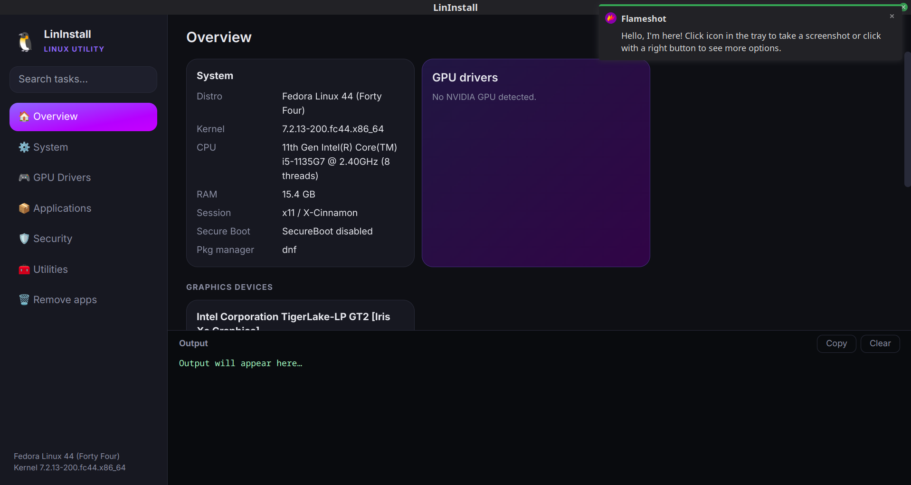

<div align="center">


# LinInstall

**A modern Linux utility with a built-in GPU driver manager.**
Update your system, install apps, fix NVIDIA drivers (even Pascal), harden security and tweak performance, all from one clean window. Designed for smoothiness.

[](LICENSE)
[](https://www.electronjs.org/)
[](https://tailwindcss.com/)
[](https://fedoraproject.org/)
[](#-supported-distros)

[Features](#-features) · [Install](#-install) · [GPU drivers](#-gpu-drivers) · [Build](#-build-from-source) · [Add your own tasks](#-add-your-own-tasks) · [FAQ](#-faq)

<br />



</div>

---

## ✨ Features

| | |
|---|---|
| 🏠 **Overview** | Distro, kernel, CPU, RAM, session type (X11/Wayland), Secure Boot state and every detected GPU with its generation |
| 🎮 **GPU drivers** | Detects your GPU and installs the right NVIDIA driver branch in one click, including **legacy Pascal / Maxwell / Volta** cards |
| ⚙️ **System** | Updates, cache cleanup, firmware updates, RPM Fusion, Flathub, codecs, build tools, SSD TRIM, swappiness |
| 📦 **Applications** | Browsers (Firefox, Chromium, Brave, Zen), dev tools (Git, Node, Python, Docker, VS Code, Zed), media, gaming and terminal tools |
| 🗑️ **Remove apps** | Tick the packages you installed and remove them, with a dry-run **Preview** first |
| 🛡️ **Security** | Firewall, Fail2ban, automatic updates, ClamAV, SELinux status, open-port overview |
| 🧰 **Utilities** | System info, SMART disk health, boot time analysis, network info, cache cleanup |
| 🔍 **Search** | One search box across every task |
| 👀 **Safe by design** | Every action shows the **exact command** and whether it needs root before it runs |

## 🧭 How it works

1. Pick a task in the sidebar (or search for it).
2. A dialog shows the exact shell command, and whether it runs as root or as your user.
3. Confirm, and the output streams live into the log panel.
4. Tasks that need root use `pkexec`, so you get the normal graphical password prompt. The app itself never runs as root.

## 🖥️ GPU drivers

LinInstall reads your GPU from `lspci` and maps the chip codename to the driver branch that actually supports it.

| Generation | Example cards | Driver branch |
|---|---|---|
| Turing, Ampere, Ada, Blackwell | GTX 16xx, RTX 20/30/40/50 | **current** |
| Maxwell, **Pascal**, Volta | GTX 750, GTX 9xx, **GTX 10xx**, Titan X/Xp, Quadro P/M | **580xx** (legacy) |
| Kepler | GTX 600/700 | 470xx (legacy) |
| Fermi | GTX 400/500 | 390xx (legacy, Fedora) |

> [!NOTE]
> NVIDIA's 580 series is the last branch that supports Maxwell, Pascal and Volta. Newer drivers dropped them, so those cards need the legacy packages.

**On Fedora** the installer enables RPM Fusion Free and Nonfree, removes any conflicting NVIDIA packages, installs `akmod-nvidia-580xx` with the matching `xorg-x11-drv-nvidia-580xx` packages (or the current / 470xx / 390xx equivalents), builds the kernel module with `akmods` and rebuilds the initramfs. Then reboot.

Extra GPU tools: nvidia-drm modeset, forced akmods rebuild, Secure Boot key-enrollment help, driver removal, AMD and Intel graphics stacks, Vulkan tools.

> [!WARNING]
> With **Secure Boot enabled**, NVIDIA kernel modules need an enrolled signing key. The app shows the steps (`kmodgenca` + `mokutil --import`), but the password prompt has to happen in a terminal. Alternatively, disable Secure Boot in your firmware settings.

## 🐧 Supported distros

| Distro family | Package manager | Status |
|---|---|---|
| Fedora | `dnf` | ✅ Best supported (developed and tested on Fedora 44, X11) |
| Ubuntu, Debian and derivatives | `apt` | 🟡 Supported (Pascal relies on `ubuntu-drivers` picking the right version) |
| Arch and derivatives | `pacman` | 🟡 Supported (legacy NVIDIA needs `yay` or `paru` for the AUR) |
| openSUSE | `zypper` | 🟠 Partial (many tasks work, NVIDIA install is not supported) |

Tasks that don't exist for your distro are greyed out with a "not supported" label instead of failing.

## 📥 Install

Grab a package from the [**Releases**](../../releases) page.

```bash
# Fedora / RHEL-based
sudo dnf install ./lininstall-<ver>.rpm

# Debian / Ubuntu
sudo apt install ./lininstall-<ver>.deb

# Any distro (AppImage)
chmod +x lininstall-<ver>.AppImage
./lininstall-<ver>.AppImage
```

The AppImage needs FUSE on Fedora: `sudo dnf install fuse-libs`.

**Requirements:** `polkit` (for `pkexec`) and `pciutils` (for `lspci`). The rpm and deb packages pull these in automatically.


Output goes to `dist/`.

<details>
<summary><b>Fedora build prerequisites</b></summary>

```bash
sudo dnf install nodejs npm rpm-build ImageMagick libxcrypt-compat
sudo npm install -g yarn

# Newer rpm versions need a current fpm (the bundled one is too old)
sudo dnf install ruby ruby-devel gcc make redhat-rpm-config
sudo gem install fpm
```

`build.sh` sets `USE_SYSTEM_FPM=true` for you. It also generates the sized icons in `build/icons/` so the package doesn't end up with a `0x0` icon folder.

</details>


## 🧩 Add your own tasks

All tasks live in [`tasks.js`](tasks.js). A task is a plain object:

```js
{ id: "htop", name: "htop", desc: "Process viewer", group: "Terminal tools", cmd: inst("htop") }
```

| Field | Meaning |
|---|---|
| `id`, `name`, `desc` | Identifier, title and description shown in the UI |
| `group` | Heading the task appears under |
| `root` | Run through `pkexec` (default `true`); set `false` for user-level commands |
| `reboot` | Show a "reboot recommended" note after success |
| `danger` | Mark the task as "careful" and style the button red |
| `cmd` | A shell string, or a function `(ctx) => string` (return nothing to mark it unsupported) |

Handy helpers:

```js
inst("pkg")                               // install a package with the detected package manager
inst("pkg", { pacman: "other-name" })     // per-distro package names (use null to mark unsupported)
by({ dnf: "...", apt: "...", pacman: "..." })   // a different command per package manager
flatpak("org.example.App")                // install a Flatpak from Flathub as your user
```


## 🔐 Security notes

- Every command is shown **before** it runs. Nothing executes silently.
- The UI runs with `contextIsolation` on and a strict Content Security Policy. Only whitelisted actions are exposed through the preload bridge.
- Root commands go through `pkexec`, so authentication is handled by polkit and not by the app.
- Package names for the remove feature are validated, and core system packages (kernel, systemd, glibc, your desktop environment, the package manager, NVIDIA drivers) are hidden from the removal list.
- Several tasks download and run vendor install scripts (Brave, Zed) or add third-party repos (VS Code). Read the command in the dialog if you want to check it first.

## ❓ FAQ

<details>
<summary><b>My GPU is detected as the wrong vendor or generation</b></summary>

Open an issue with the output of `lspci -nn | grep -Ei 'vga|3d|display'` and your distro version.

</details>

<details>
<summary><b>The NVIDIA driver installed but I'm still on nouveau</b></summary>

On Fedora the kernel module builds in the background and takes a few minutes. Wait for it to finish (`modinfo -F version nvidia` should print a version), then reboot. If Secure Boot is on, the module also needs an enrolled key.

</details>

<details>
<summary><b>The icon doesn't show after installing the rpm</b></summary>

Check that the package contains sized icons: `rpm -qlp dist/*.rpm | grep icons`. Then refresh the cache: `sudo gtk-update-icon-cache -f /usr/share/icons/hicolor`.

</details>

<details>
<summary><b>Is this affiliated with linutil?</b></summary>

No. LinInstall is an independent project inspired by [ChrisTitusTech/linutil](https://github.com/ChrisTitusTech/linutil) and shares no code with it.

</details>

## 🗺️ Roadmap

- [ ] Custom task profiles and one-click "setup presets"
- [ ] Per-distro task testing on Ubuntu and Arch
- [ ] Wayland-specific tweaks
- [ ] Update notifications for the app itself

## 🤝 Contributing

Issues and pull requests are welcome. To add a task, edit `tasks.js`, run it with `yarn start`, and please say which distro you tested it on.

Do not create any similar phishing and scam related program from this source!

This project should be for linux community made by love and enthusiasm


## 💜 Community & responsible use
 
LinInstall is made for the Linux community, with love and enthusiasm.
 
Please **do not** use this source to build phishing tools, scams, malware or anything else meant to deceive or harm people. Contributions with that kind of purpose will not be accepted.

## 📄 License

Released under the [MIT License](LICENSE). Copyright © 2026 NoCapScripts.

<div align="center">
<sub>Made by NoCapScripts </sub>
</div>
